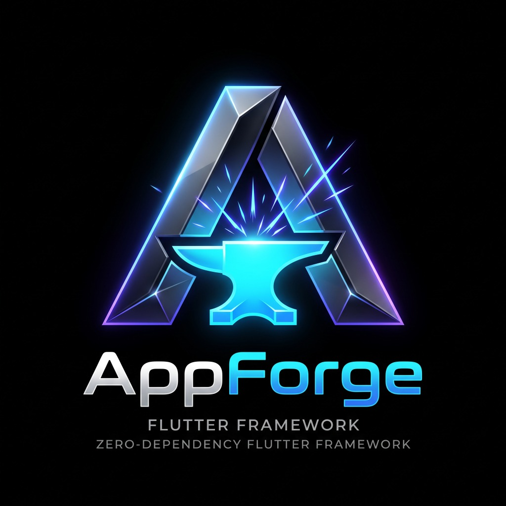
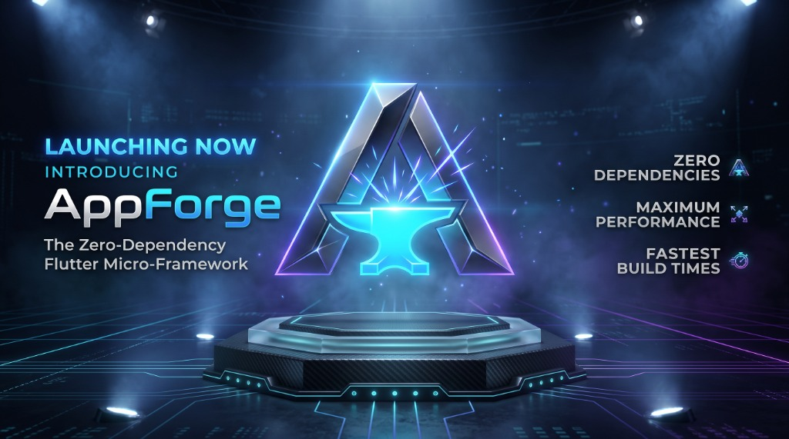
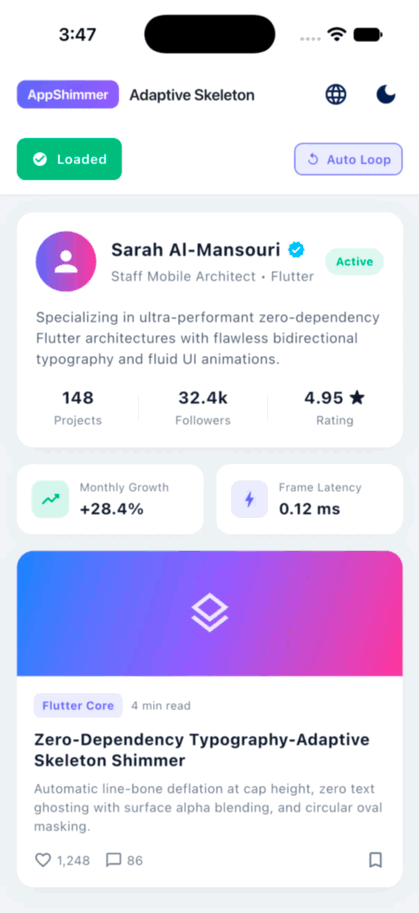
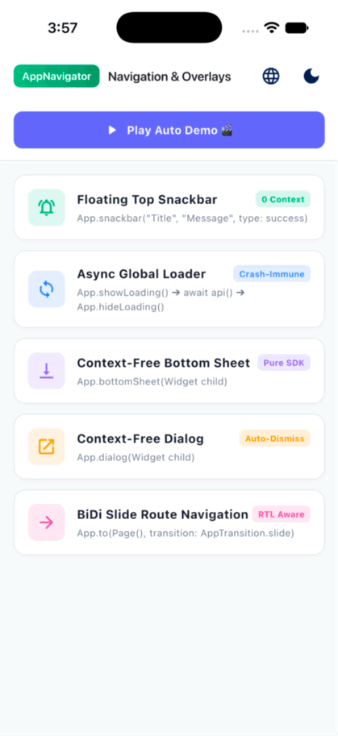
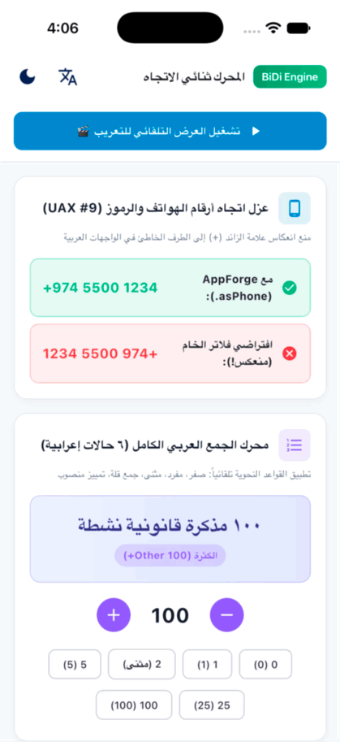
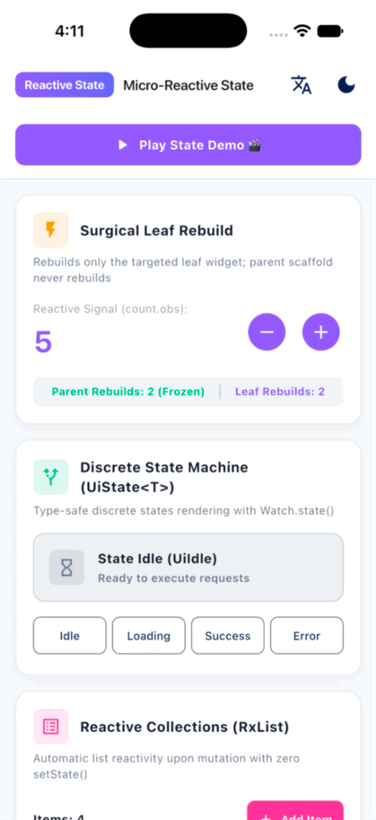
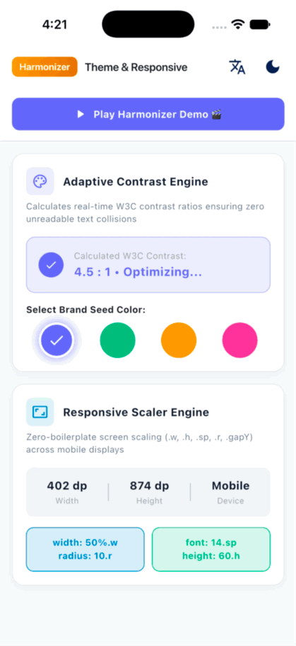

<p align="center">
  
</p>

<h1 align="center">AppForge</h1>

<p align="center">
  <strong>A high-performance, zero-dependency Flutter micro-framework.</strong><br>
  Reactive State • Context-Free Navigation & Overlays • BiDi & Arabic Localization • Smart Adaptive Theming • Responsive Scaling • Resource Cleaner • Atomic Storage
</p>

<p align="center">
  <a href="https://pub.dev/packages/appforge"></a>
  <a href="https://pub.dev/packages/appforge/score"></a>
  
  
  
  
  
  <a href="https://github.com/sponsors/Dhia-Bechattaoui"></a>
  <a href="https://ko-fi.com/I5L22ACCSH"></a>
</p>

<p align="center">
  
</p>

<p align="center">
  
  
  
  
  
</p>

---

## Why AppForge?

Modern Flutter applications often pull in 10+ third-party packages just for state, routing, localization, screen scaling, and dialogs. This introduces version locks, dependency graph conflicts, heavy bundle size, and transitive upgrade churn across Flutter SDK updates.

**AppForge replaces them all with strictly ZERO external dependencies across Android, iOS, Desktop, and Web:**
- **0 External Packages**: Uses only the Dart Standard Library and Flutter SDK (supports all 6 Flutter platforms including **Flutter Web**).
- **Context-Free Across Async Gaps**: Trigger routing, snackbars, dialogs, and loaders from any service, callback, or controller without passing `BuildContext`.
- **First-Class Test Isolation**: Swap dependencies with `App.override<T>()` / `AppTestScope`, record controller navigation calls with `App.recordNavigationForTesting()`, and reset all global state in one line via `App.resetForTesting()`.
- **Crash-Resilient Storage with Optional Codec**: Atomic POSIX persistence on mobile/desktop (`dart:io`) and `localStorage` on Web, observable error hooks (`onError`, `throwOnCorrupt`), and `AppStorageCodec` for application-level encryption *(default JSON storage is unencrypted and meant for preferences/non-sensitive local state)*.
- **World-Class BiDi & Arabic Engine**: Automatic Unicode UAX #9 directional isolation for mixed Arabic+Latin text, leading `+` phone number preservation, and full 6-form Arabic pluralization.
- **Micro-Reactive State**: Atomic `.obs` variables, discrete `UiState<T>` machines, and surgical `Watch` leaf rebuilding.
- **Automated Cleaner & Lossless Rollback**: Built-in CLI (`dart run appforge:clean --fix`) to audit and prune dead translations, unused assets, and orphan Dart files, with 1-second lossless undo via `dart run appforge:clean --revert`.

---

## Architecture Overview

```
appforge/
├── core/           # App global facade, MasterApp root container, AppController lifecycle
├── state/          # Service locator (DI), Rx<T> primitives, Watch widget, UiState machine
├── navigation/     # Context-free router, dialogs, snackbars, bottom sheets, global loader
├── localization/   # BiDi sanitizers, Unicode UAX #9 isolates, 6-case Arabic plurals, .tr
├── theme/          # Light/Dark/System theme switcher and custom token extensions
├── responsive/     # Screen scaler (.w, .h, .sp, .r, .gapX, .gapY)
├── cleaner/        # Static codebase scanner, cross-locale auditor, and --fix CLI pruner
└── utils/          # Form validators, input formatters, and context extensions
```

---

## 1. Quick Start

Wrap your application in `MasterApp`:

```dart
import 'package:flutter/material.dart';
import 'package:appforge/appforge.dart';

void main() {
  runApp(
    MasterApp(
      title: 'AppForge Demo',
      initialRoute: const HomeScreen(),
      translations: MyTranslations(),
      theme: ThemeData.light(),
      darkTheme: ThemeData.dark(),
      defaultTransition: AppTransition.slide, // Direction-aware (LTR/RTL)
    ),
  );
}
```

---

## 2. Core Capabilities

### A. Typography-Adaptive Skeleton Shimmer Engine (`AppShimmer`)

Zero-boilerplate skeleton shimmer that inspects layout geometry automatically with cap-height deflation, exact oval avatar masking, and Arabic sub-baseline descender coverage:

<p align="center">
  
</p>

```dart
// 1. Shimmer any widget tree directly without duplicate layout code:
UserProfileCard(user: user).shimmer(enabled: isLoading);

// 2. Or wrap via root container:
AppShimmer(
  enabled: isLoading,
  child: const ProductFeed(),
);

// 3. Built-in atomic skeleton placeholders:
AppShimmer.circle(radius: 28);
AppShimmer.box(width: 140, height: 16, borderRadius: 8);
AppShimmer.text(lines: 3, spacing: 8);
```

### B. Context-Free Navigation & Overlays

Navigate routes and trigger floating overlays from anywhere across async gaps without passing `BuildContext`:

<p align="center">
  
</p>

```dart
// 1. Context-Free Navigation with BiDi-Aware Transitions
App.to(const DetailScreen(), transition: AppTransition.slide, arguments: {'id': 42});
App.back('Saved safely');
App.off(const LoginScreen());
App.offAll(const DashboardScreen());

// 2. Semantic Floating Snackbars
App.snackbar('نجاح', 'تمت مزامنة البيانات دون BuildContext', type: AppSnackbarType.success);

// 3. Modal Dialogs & Bottom Sheets
App.dialog(const ConfirmationDialog());
App.bottomSheet(const FilterBottomSheet());

// 4. Crash-Immune Global Screen Loader
App.showLoading(message: 'جاري الحفظ...');
await syncData();
App.hideLoading();
```

### C. World-Class BiDi & Arabic Localization Engine

The most comprehensive zero-dependency Arabic and bidirectional engine in the Flutter ecosystem:

<p align="center">
  
</p>

```dart
// 1. Automatic Mixed-Script Isolation (Unicode UAX #9)
// In mixed text, Latin tokens are isolated automatically without manual marks:
'النمط الحالي: system'.tr; // 'system' stays cleanly at the visual end in RTL

// 2. Phone Number & Symbol Direction Protection
// Prevents leading '+' sign from flipping in Arabic layouts:
'+974 5500 1234'.asPhone; // Unicode LRI isolate

// 3. Full 6-Form Arabic Pluralization
// Automatically selects: zero, one, two (المثنى), few (3-10), many (11-99), or other (100+)
'cases'.trPlural(quantity, params: {'count': quantity.toString().toArabicDigits});

// 4. Grammatical Gender Inflection (التذكير والتأنيث)
'user_greeting'.trGender(AppGender.female, {'name': 'سارة'});
'شكراً لكَ'.inflectArabicGender(AppGender.female); // -> 'شكراً لكِ'

// 5. Arabic Orthography & Tashkeel Sanitization
'أحمد'.normalizeArabic; // -> 'احمد'
'شُكْرًا'.stripTashkeel; // -> 'شكرا' (Strips all 9 Harakat marks)
'مَلَفّ'.fuzzyContainsArabic('ملف'); // -> true
```

#### ⚡ Why AppForge Translations Are Superior: Instant Hot Reload (0ms, No App Restart)
- **Live Updates on Save (Zero App Restart)**: Unlike legacy frameworks (such as GetX) that freeze dictionaries into static singletons on boot—forcing developers to hot-restart the entire app and lose active screen state whenever a translation is edited—AppForge evaluates translations reactively through dynamic getters. When you modify any text in `AppTranslations` and press Save (`Cmd+S`), Flutter's Hot Reload updates the UI **instantly in 0ms**.
- **Pure In-Memory Speed & Zero Bloat**: No JSON file I/O overhead, no asset bundle parsing, no `intl` code-generation (`build_runner`) delay, and strictly 0 dependencies.
- **Universal Built-in Dictionary**: Standard mobile buttons (`'save'.tr`, `'cancel'.tr`, `'close'.tr`, `'delete'.tr`, `'retry'.tr`, `'loading'.tr`) work out-of-the-box with zero configuration.

### D. Micro-Reactive State Management & Discrete Machines

Atomic signals with surgical leaf rebuilding that prevents screen-wide layout thrashing:

<p align="center">
  
</p>

```dart
// 1. Reactive Primitive
final counter = 0.obs;
counter.value++;

// 2. Surgical Leaf Rebuilding (Only this Text widget re-renders, 0 parent rebuilds)
Watch((context) => Text('Count: ${counter.value}'));

// 3. Type-Safe Discrete UI State Machine
final authState = const UiState<String>.idle().obs;

Watch.state<String>(
  state: authState,
  onIdle: (ctx) => const Text('Ready'),
  onLoading: (ctx) => const CircularProgressIndicator(),
  onSuccess: (ctx, token) => Text('Token: $token'),
  onFailure: (ctx, error, raw) => Text('Error: $error'),
);

// 4. Reactive Collections
final tasks = <String>['Task 1', 'Task 2'].obs;
tasks.add('Task 3'); // Automatically triggers targeted listeners

// 5. Route-Bound Dependency Injection (Auto-disposed when screen pops)
App.put<ProfileController>(ProfileController());
final controller = App.find<ProfileController>();
```

### E. Smart Adaptive Theming & Responsive Scaling

```dart
// 1. Dynamic Theming with WCAG AA Auto-Contrast Harmonization
App.toggleTheme();
App.setThemeMode(ThemeMode.dark);

// 2. Responsive Scaling (.w, .h, .sp, .r) across mobile displays
Container(
  width: 200.w,
  height: 50.h,
  padding: EdgeInsets.all(16.r),
  child: Text('Scaled Headline', style: TextStyle(fontSize: 16.sp)),
);

// 3. Ergonomic Spacing Shortcuts
16.gapY; // SizedBox(height: 16)
8.gapX;  // SizedBox(width: 8)
```

<p align="center">
  
</p>

### F. Automated Project Cleaner & Lossless Rollback CLI

AppForge includes a standalone pure-Dart CLI that audits, prunes, and safely restores translations, assets, and orphan files:

```bash
# 1. Audit project resources (translations, assets, and orphan Dart files)
dart run appforge:clean

# 2. Automatically prune dead translations, assets, and orphan files with safe backups
dart run appforge:clean --fix

# 3. Lossless rollback: undo the previous cleanup in 1 second
dart run appforge:clean --revert

# 4. Machine-readable output for CI/CD integration
dart run appforge:clean --json
```

---

## 3. Comparison

| Feature | AppForge | GetX | Bloc | Riverpod |
| :--- | :---: | :---: | :---: | :---: |
| **Core Package Dependencies** | **0** | 0 (SDK only) | 1 (`meta`) | Multiple (`collection`, `riverpod`) |
| **Full-Stack Ecosystem Dependencies**<br>*(State, Nav, Storage, Responsive, Shimmer)* | **0 (Only `appforge`)** | **Multiple** (`get_storage` + `path_provider` + `screenutil` + `shimmer`) | **Multiple** (`bloc` + `shared_preferences` + `go_router` + `screenutil`) | **Multiple** (`riverpod` + `shared_preferences` + `go_router` + `screenutil`) |
| **Crash-Immune Atomic Storage** | **Built-in (`AppStorage`)** | Requires `get_storage` (needs `path_provider`) | Requires `shared_preferences` / `hive` | Requires `shared_preferences` / `hive` |
| **Responsive Sizing (`.w`, `.h`, `.sp`)** | **Built-in (`AppResponsive`)** | Requires `flutter_screenutil` | Requires `flutter_screenutil` | Requires `flutter_screenutil` |
| **Adaptive Skeleton Shimmer** | **Built-in (`AppShimmer`)** | Requires `shimmer` | Requires `shimmer` | Requires `shimmer` |
| **Translation Hot Reload** | **Instant 0ms (No Restart)** | Requires Hot Restart | Requires CodeGen / Restart | Requires CodeGen / Restart |
| **Context-Free Navigation** | **Yes** | Yes | No (`BuildContext`) | No (`BuildContext`) |
| **BiDi Unicode UAX #9 Engine** | **Native Built-in** | No | No | No |
| **6-Case Arabic Pluralization** | **Native Built-in** | No | Requires `intl` | Requires `intl` |
| **Dead-Key Pruner CLI (`--fix`)**| **Native Built-in** | No | No | No |
| **Memory Leak Protection** | **Auto-disposed Routes** | Manual / Fragile | Auto-dispose (`BlocProvider`) | Auto-dispose (`autoDispose`) |

---

## 4. Documentation & AI Reference

- [AI.md](AI.md): **AI & Agent Guide** — Complete syntax reference, design patterns, and anti-patterns for AI assistants.
- [llms.txt](llms.txt): Machine-readable LLM context manifest.
- [SPECIFICATION.md](SPECIFICATION.md): Framework technical architecture.
- [CHANGELOG.md](CHANGELOG.md): Semantic version history and release notes.

---

## ❤️ Support & Sponsor

Developing and maintaining **AppForge** as an all-in-one, zero-dependency, crash-immune micro-framework requires dedicated full-time engineering, continuous benchmarking, and thorough documentation.

If AppForge makes your Flutter development faster, cleaner, or saves your projects from dozens of third-party package dependencies, please consider sponsoring:

<p align="center">
  <a href="https://ko-fi.com/I5L22ACCSH">
    
  </a>
</p>

- **Ko-fi**: [ko-fi.com/I5L22ACCSH](https://ko-fi.com/I5L22ACCSH) — Monthly memberships, 1-on-1 architecture audits, and starter kits.
- **GitHub Sponsors**: [github.com/sponsors/Dhia-Bechattaoui](https://github.com/sponsors/Dhia-Bechattaoui)
- **Star on GitHub**: Give the repository a ⭐ on [GitHub](https://github.com/Dhia-Bechattaoui/appforge) to help it reach more Flutter developers.

Your sponsorship directly supports ongoing development, bug fixes, BiDi engine optimizations, and new micro-framework capabilities.

---

## License

MIT License. Developed by Dhia Bechattaoui and AppForge Contributors.
