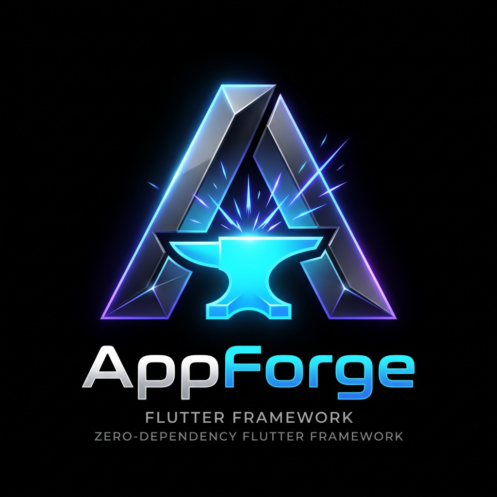
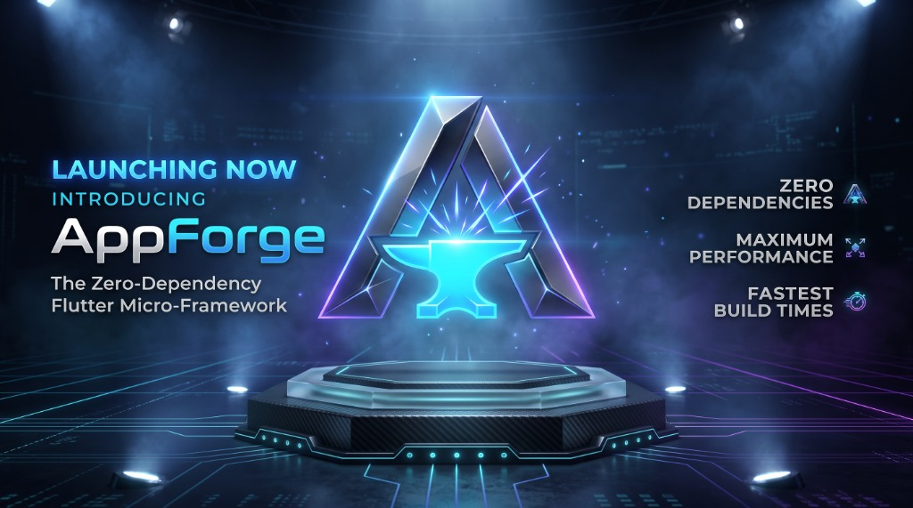

<p align="center">
  
</p>

<h1 align="center">AppForge</h1>

<p align="center">
  <strong>A high-performance, zero-dependency Flutter micro-framework.</strong><br>
  Reactive State • Context-Free Navigation & Overlays • BiDi & Arabic Localization • Smart Adaptive Theming • Responsive Scaling • Resource Cleaner • Atomic Storage
</p>

<p align="center">
  
  
  
  
  
</p>

<p align="center">
  
</p>

---

## Why AppForge?

Modern Flutter applications often pull in 10+ third-party packages just for state, routing, localization, screen scaling, and dialogs. This introduces version locks, dependency graph conflicts, heavy bundle size, and supply-chain vulnerabilities.

**AppForge replaces them all with strictly ZERO external dependencies:**
- **0 External Packages**: Uses only the Dart Standard Library and Flutter SDK.
- **Context-Free Across Async Gaps**: Trigger routing, snackbars, dialogs, and loaders from any service, callback, or controller without passing `BuildContext`.
- **World-Class BiDi & Arabic Engine**: Automatic Unicode UAX #9 directional isolation for mixed Arabic+Latin text, leading `+` phone number preservation, and full 6-form Arabic pluralization.
- **Micro-Reactive State**: Atomic `.obs` variables, discrete `UiState<T>` machines, and surgical `Watch` leaf rebuilding.
- **Automated Cleaner & Lossless Rollback**: Built-in CLI (`dart run appforge:clean --fix`) to audit and prune dead translations, unused assets, and orphan Dart files, with 1-second lossless undo via `dart run appforge:clean --revert`.

---

## Architecture Overview

```
appforge/
├── core/           # App global facade, MasterApp root container, AppController lifecycle
├── state/          # Service locator (DI), Rx<T> primitives, Watch widget, UiState machine
├── navigation/     # Context-free router, dialogs, snackbars, bottom sheets, global loader
├── localization/   # BiDi sanitizers, Unicode UAX #9 isolates, 6-case Arabic plurals, .tr
├── theme/          # Light/Dark/System theme switcher and custom token extensions
├── responsive/     # Screen scaler (.w, .h, .sp, .r, .gapX, .gapY)
├── cleaner/        # Static codebase scanner, cross-locale auditor, and --fix CLI pruner
└── utils/          # Form validators, input formatters, and context extensions
```

---

## 1. Quick Start

Wrap your application in `MasterApp`:

```dart
import 'package:flutter/material.dart';
import 'package:appforge/appforge.dart';

void main() {
  runApp(
    MasterApp(
      title: 'AppForge Demo',
      initialRoute: const HomeScreen(),
      translations: MyTranslations(),
      theme: ThemeData.light(),
      darkTheme: ThemeData.dark(),
      defaultTransition: AppTransition.slide, // Direction-aware (LTR/RTL)
    ),
  );
}
```

---

## 2. Core Capabilities

### A. Reactive State Management & Dependency Injection

```dart
// 1. Reactive primitive
final counter = 0.obs;
counter.value++;

// 2. Surgical UI Rebuilding (Only rebuilds this Text widget)
Watch((context) => Text('Count: ${counter.value}'))

// 3. Discrete UI State Machine
final profileState = UiState<UserProfile>.loading().obs;

Watch.state<UserProfile>(
  state: profileState,
  onData: (user) => Text('Welcome, ${user.name}'),
  onError: (err) => Text('Error: $err'),
  onLoading: () => const CircularProgressIndicator(),
)

// 4. Route-bound Dependency Injection (Auto-disposed when screen pops)
App.put<AuthController>(AuthController());
final auth = App.find<AuthController>();
```

### B. Context-Free Navigation & Overlays

Navigate or trigger overlays from background callbacks without `BuildContext`:

```dart
// Navigation
App.to(const DetailScreen(), arguments: {'id': 42});
App.back(result: 'Saved');
App.off(const LoginScreen());
App.offAll(const DashboardScreen());

// Snackbars
App.snackbar('Success', 'Profile saved to cloud!', type: SnackType.success);

// Modal Dialogs & Bottom Sheets
App.dialog(const ConfirmationDialog());
App.bottomSheet(const FilterBottomSheet());

// Global Screen Loader
App.showLoading(message: 'Syncing...');
await syncData();
App.hideLoading();
```

### C. BiDi & Arabic Localization Engine

AppForge provides the most advanced zero-dependency Arabic localization engine in the Flutter ecosystem:

```dart
// 1. Automatic Mixed-Script Isolation (Unicode UAX #9)
// In mixed text, Latin tokens are isolated automatically without manual marks:
'النمط الحالي: system'.tr; // 'system' stays cleanly at the visual end in RTL

// 2. Phone Number Protection
// Prevents leading '+' sign from flipping in Arabic layouts:
'+974 5500 1234'.asPhone; // Unicode LRI isolate

// 3. Full 6-Form Arabic Pluralization
// Selects: zero, one, two, few (3-10), many (11-99), or other (100+)
'cases'.trPlural(quantity, params: {'count': '$quantity'});

// 4. Grammatical Gender Inflection (التذكير والتأنيث)
'user_greeting'.trGender(AppGender.female, {'name': 'Sara'});
'شكراً لكَ'.inflectArabicGender(AppGender.female); // -> 'شكراً لكِ'

// 5. Arabic Orthography & Fuzzy Search
'أحمد'.normalizeArabic; // -> 'احمد'
'شُكْرًا'.stripTashkeel; // -> 'شكرا' (Strips all 9 Harakat marks)
'مَلَفّ'.fuzzyContainsArabic('ملف'); // -> true
```

#### ⚡ Why AppForge Translations Are Superior: Instant Hot Reload (0ms, No App Restart)
- **Live Updates on Save (Zero App Restart)**: Unlike legacy frameworks (such as GetX) that freeze dictionaries into static singletons on boot—forcing developers to hot-restart the entire app and lose active screen state whenever a translation is edited—AppForge evaluates translations reactively through dynamic getters. When you modify any text in `AppTranslations` and press Save (`Cmd+S`), Flutter's Hot Reload updates the UI **instantly in 0ms**.
- **Pure In-Memory Speed & Zero Bloat**: No JSON file I/O overhead, no asset bundle parsing, no `intl` code-generation (`build_runner`) delay, and strictly 0 dependencies.
- **Universal Built-in Dictionary**: Standard mobile buttons (`'save'.tr`, `'cancel'.tr`, `'close'.tr`, `'delete'.tr`, `'retry'.tr`, `'loading'.tr`) work out-of-the-box with zero configuration.

### D. Dynamic Theming & Responsive Scaling

```dart
// Dynamic Theming
App.setThemeMode(ThemeMode.dark);
App.toggleTheme();
final isDark = context.isDark;

// Responsive Scaling (Adapts cleanly to phone and tablet viewports)
Container(
  width: 200.w,
  height: 50.h,
  padding: EdgeInsets.all(16.r),
  child: Text('Scaled Text', style: TextStyle(fontSize: 14.sp)),
);

// Quick Spacers
16.gapY; // SizedBox(height: 16)
8.gapX;  // SizedBox(width: 8)
```

### E. Automated Project Cleaner & Lossless Rollback CLI

AppForge includes a standalone pure-Dart CLI that audits, prunes, and safely restores translations, assets, and orphan files:

```bash
# 1. Audit project resources (translations, assets, and orphan Dart files)
dart run appforge:clean

# 2. Automatically prune dead translations, assets, and orphan files with safe backups
dart run appforge:clean --fix

# 3. Lossless rollback: undo the previous cleanup in 1 second
dart run appforge:clean --revert

# 4. Machine-readable output for CI/CD integration
dart run appforge:clean --json
```

---

## 3. Comparison

| Feature | AppForge | GetX | Bloc / Riverpod |
| :--- | :---: | :---: | :---: |
| **External Dependencies** | **0** | Multiple | Multiple |
| **Translation Hot Reload** | **Instant 0ms (No App Restart)** | Requires Hot Restart | Requires CodeGen / Restart |
| **Context-Free Navigation** | **Yes** | Yes | No |
| **BiDi Unicode UAX #9 Engine** | **Native Built-in** | No | No |
| **6-Case Arabic Pluralization** | **Native Built-in** | No | Requires `intl` |
| **Dead-Key Pruner CLI (`--fix`)**| **Native Built-in** | No | No |
| **Responsive Sizing (`.w`, `.h`)** | **Native Built-in** | No | Requires `screenutil` |
| **Memory Leak Protection** | **Auto-disposed Routes** | Manual/Fragile | Auto-dispose |

---

## 4. Documentation & AI Reference

- [AI.md](AI.md): **AI & Agent Guide** — Complete syntax reference, design patterns, and anti-patterns for AI assistants.
- [llms.txt](llms.txt): Machine-readable LLM context manifest.
- [SPECIFICATION.md](SPECIFICATION.md): Framework technical architecture.
- [CHANGELOG.md](CHANGELOG.md): Semantic version history and release notes.

---

## License

MIT License. Developed by Dhia Bechattaoui and AppForge Contributors.
